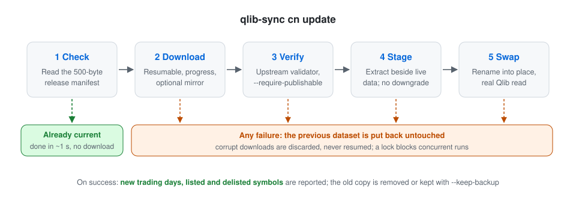
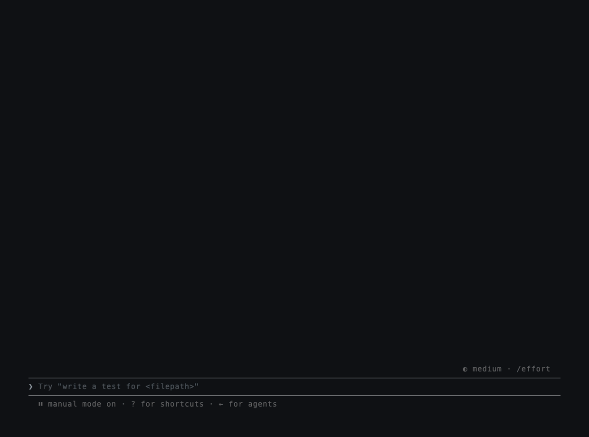

# qlib-sync

[](https://github.com/randyy179/qlib-sync/actions/workflows/ci.yml)
[](https://pypi.org/project/qlib-sync/)
[](LICENSE)

[中文说明](README.zh-CN.md)

**Website:** [randyy179.github.io/qlib-sync](https://randyy179.github.io/qlib-sync/)

<!-- mcp-name: io.github.randyy179/qlib-sync -->

**One command to install and keep current a local [Qlib](https://github.com/microsoft/qlib) China A-share dataset, and an MCP server so AI assistants can read it.**

```bash
pip install qlib-sync
qlib-sync cn update
```

Or without installing anything first: `uvx qlib-sync cn update`.


That installs the daily community release from
[chenditc/investment_data](https://github.com/chenditc/investment_data) into
`~/.qlib/qlib_data/cn_data`, the location Qlib reads by default. Run the same command again
any time; when the data is already current it finishes in about a second.

## Why not just `wget` and `tar`?

Qlib's README points A-share users to the community release with a `wget` and `tar` one-liner.
That works until it doesn't:

- **An interrupted or truncated download** extracts into a half-written dataset, or fails
  after the old one has already been overwritten.
- **Upstream republishes releases.** In November 2026 a data error was found and corrected
  ([investment_data#163](https://github.com/chenditc/investment_data/issues/163)) and releases
  were republished under the same date. A date check alone never sees the fix.
- **Every check downloads 550 MB**, even when nothing changed.

qlib-sync treats the dataset like a production system:

<picture>
  <source media="(prefers-color-scheme: dark)" srcset="docs/assets/update-flow-dark.svg">
  
</picture>

| Step | What happens |
|---|---|
| Check | Reads the release's 500-byte manifest. Already current: done, nothing downloaded. |
| Download | Resumes interrupted downloads; shows progress; optional mirror for slow links to GitHub. |
| Verify | Size and sha256 from the manifest; the calendar must end on the manifest's trade date; archive paths and links are checked before extraction. |
| Stage | Extracts next to the active dataset; refuses downgrades. |
| Swap | Renames the new dataset into place, then runs a real Qlib read. |
| Roll back | Any failure after the swap moves the previous dataset back. |
| Report | New trading days, newly listed and delisted symbols. |

The checks catch broken, truncated, or tampered packages. They cannot catch wrong values inside a
correctly published release (like the one in #163); for that, keep a rollback copy with
`--keep-backup`.

## Commands

```bash
qlib-sync status                  # every local Qlib dataset at a glance
qlib-sync cn status               # local date, pools, and whether a newer release exists
qlib-sync cn update               # install or update (add --json for machine-readable output)
qlib-sync cn health-check         # structure checks plus a real Qlib read
qlib-sync cn restore --list       # rollback backups; restore --yes switches back
```

Useful options for `cn update`:

| Option | Effect |
|---|---|
| `--data-dir PATH` | Install somewhere other than `~/.qlib/qlib_data/cn_data` |
| `--mirror URL` | Download through a prefix-style GitHub proxy such as `https://ghfast.top` (or set `QLIB_SYNC_MIRROR`) |
| `--keep-backup` | Keep the previous dataset for one rollback |
| `--protect FILE` | Carry a custom stock pool in `instruments/` across updates (repeatable) |
| `--force` | Reinstall even when the dates match |

**The update replaces the whole `cn_data` folder.** Anything you added there is lost unless you
pass it with `--protect`.

### Mirrors

From mainland China, GitHub downloads can be slow or fail. Pass a mirror and qlib-sync downloads
the package through it while still reading the manifest from GitHub directly when it can, so the
checksum does not depend on the mirror. Mirrors are third-party services; qlib-sync does not
endorse any of them.

## Python

```python
from qlib_sync import update_cn, status_cn, health_check_cn

result = update_cn()                 # raises qlib_sync.UpdateError on failure; data unchanged
print("\n".join(result.summary_lines()))
print(result.new_trading_days, result.added_symbols)
```

## Use it from Claude and other AI assistants

The MCP server runs locally: your assistant starts it on demand and it reads the dataset on
your machine. There is no service to host and nothing leaves your computer.

**Claude Desktop:** download `qlib-sync.mcpb` from the
[latest release](https://github.com/randyy179/qlib-sync/releases/latest) and open it. Claude
installs Python and the dependencies itself.

**Claude Code:**

```bash
claude mcp add qlib-sync -- uvx qlib-sync mcp
```

**Other MCP clients:** run `uvx qlib-sync mcp` as a stdio server. It is also listed in the
[MCP Registry](https://registry.modelcontextprotocol.io) as `io.github.randyy179/qlib-sync`.

```json
{ "mcpServers": { "qlib-sync": { "command": "uvx", "args": ["qlib-sync", "mcp"] } } }
```

Set `QLIB_SYNC_DATA_DIR` to use a dataset outside `~/.qlib/qlib_data/cn_data`, and
`QLIB_SYNC_MIRROR` to download through a mirror.

| Tool | Does |
|---|---|
| `cn_status` | Local latest date, pools, and whether an update is available |
| `cn_update` | Install or update (safe to call: failures restore the previous data) |
| `cn_health_check` | Structure checks plus a real Qlib read |
| `cn_get_prices` | Daily bars for up to 20 symbols; real traded prices by default, adjusted on request |
| `cn_list_pool` | Members of csi300, csi500, and other pools on a date |

Then ask things like *"Is my A-share data current? What did Moutai close at over the last
week?"* Symbols accept `600519`, `SH600519`, or `600519.SH`.



[`skills/qlib-sync`](skills/qlib-sync/SKILL.md) is a Claude skill that teaches an assistant when
to update, how to read each failure, and the price conventions. Copy it into your skills folder.

## Daily updates

A run that finds nothing new costs one small request, so schedule it daily. See
[docs/scheduling.md](docs/scheduling.md) for cron and launchd examples.

## Data and credits

All data comes from [chenditc/investment_data](https://github.com/chenditc/investment_data)
(Apache-2.0). qlib-sync only downloads the public release; it does not host or redistribute
data. Prices follow Qlib's convention: `$close` is adjusted and the real price is
`$close / $factor`.

qlib-sync is an independent project, not affiliated with Microsoft or the Qlib team.

Supported: macOS and Linux, Python 3.10 to 3.12 (pyqlib does not publish wheels for newer
versions yet; `uvx` picks a compatible Python automatically).

## Development

```bash
uv venv && uv pip install -e ".[dev]"
.venv/bin/python -m pytest
```

## License

MIT
