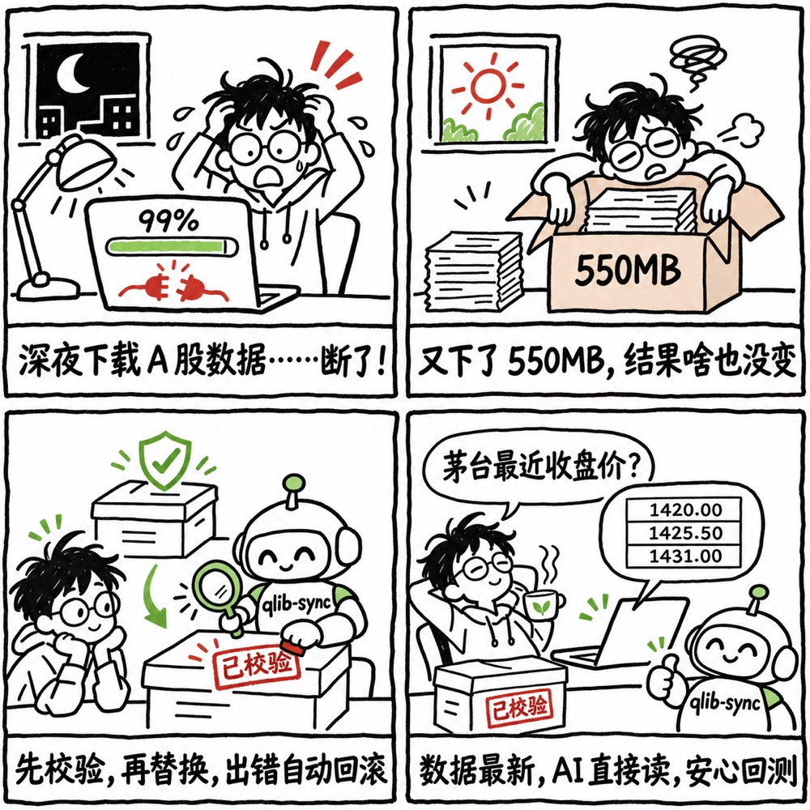
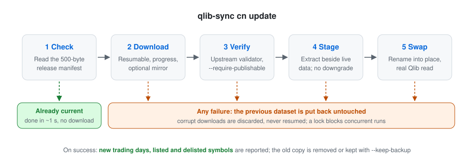
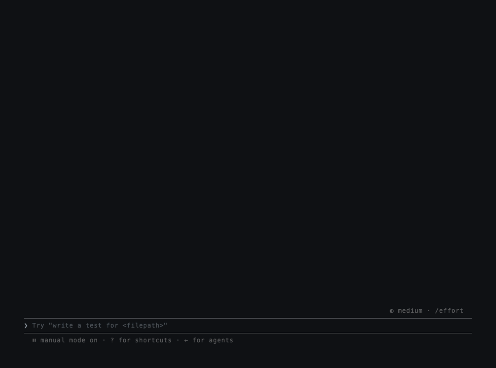

# qlib-sync

[English](README.md)

**网站：**[randyy179.github.io/qlib-sync](https://randyy179.github.io/qlib-sync/)

**一条命令安装并保持更新本地 [Qlib](https://github.com/microsoft/qlib) A 股数据，并提供 MCP server，让 AI 助手直接读取。**

```bash
pip install qlib-sync
qlib-sync cn update
```

也可以不预先安装，直接运行：`uvx --python 3.12 qlib-sync cn update`。
（加 `--python 3.12` 是因为 pyqlib 只提供到 Python 3.12 的安装包，需要时 uv 会自动下载这个版本的 Python。用 pip 安装时请使用 Python 3.10 到 3.12。）


数据来自 [chenditc/investment_data](https://github.com/chenditc/investment_data) 每天的社区发布，安装到 Qlib 默认读取的位置 `~/.qlib/qlib_data/cn_data`。原来的 Qlib 代码不用改。之后随时再运行同一条命令，数据已是最新时大约 1 秒结束。

## 为什么不直接 `wget` 加 `tar`？



Qlib 的 README 推荐用 `wget` 下载社区数据包再用 `tar` 解压。平时没问题，但会遇到这些情况：

- **下载中断或不完整**：解压出半截数据，或者旧数据已经被覆盖了才发现失败。
- **上游会重新发布**：2026 年 11 月，上游发现并修正了一处数据错误（[investment_data#163](https://github.com/chenditc/investment_data/issues/163)），用同一个日期重新发布了数据包。只比较日期的话，永远拿不到修复后的数据。
- **每次检查都要下载 550MB**，即使什么都没变。

investment_data 自己的 README 也给出了一套严谨的手动流程：下载发布清单（manifest），用 `qlib/validate_archive.py --require-publishable` 校验数据包，再解压。qlib-sync 每次更新都直接运行这个校验器：用的是未经修改的原文（来自 [commit 68fdc66](https://github.com/chenditc/investment_data/blob/68fdc66b109459e522050c94723684525aea23ab/qlib/validate_archive.py)，Apache-2.0 协议），下载前校验 manifest，下载后校验数据包。我们有一组测试，把同样的坏数据分别交给上游脚本和 qlib-sync，要求两边结论完全一致；每周还有自动任务检查上游是否修改了校验器。

在此之外，qlib-sync 补上了手动流程做不到的部分：没有新数据时不下载；把 manifest 和数据包锁定在同一个发布版本；在旧数据旁边解压，通过后整体切换、失败回滚（而不是直接解压覆盖到现有目录）；能拿到上游重新发布的修复版。

qlib-sync 把本地数据当生产系统来管理：

<picture>
  <source media="(prefers-color-scheme: dark)" srcset="docs/assets/update-flow-dark.svg">
  
</picture>

| 步骤 | 做什么 |
|---|---|
| 检查 | 锁定最新发布的版本号，读取它附带的 500 字节 manifest。已是最新就结束，不下载 |
| 下载 | 支持断点续传、显示进度；网络慢时可走镜像 |
| 校验 | 运行 investment_data 自己的 `validate_archive.py --require-publishable`（原文未改）：manifest 字段和格式、大小和 sha256、所有必需的交易日历和指数成分、日期格式、排序、未来交易日历。它拒绝的一律不装 |
| 准备 | 解压到旧数据旁边的临时目录；拒绝降级 |
| 切换 | 把新数据换上去，再用 Qlib 实际读一次 |
| 回滚 | 切换后任何一步失败，自动换回旧数据 |
| 汇报 | 新增了哪些交易日、新上市和退市的股票 |

**默认必须通过校验。** manifest 缺失、读不了或被校验器拒绝时，更新会停止，原有数据保持不变。`--allow-unverified` 可以在 manifest 无法校验时仍然安装，此时结果和安装记录都会标明“未校验”；但如果 manifest 有效而数据包的校验值对不上，无论如何都会拒绝。

这些校验能挡住损坏、不完整、被篡改或格式不对的数据包，**挡不住上游正常发布的数据里本身的数值错误**（比如 #163 那种）。需要防这类问题时，可以加 `--keep-backup` 保留一份可回滚的旧数据。

## 命令

```bash
qlib-sync status                  # 所有本地 Qlib 数据集一览
qlib-sync cn status               # 本地到哪天、有哪些股票池、远端有没有更新
qlib-sync cn update               # 安装或更新（加 --json 输出机器可读结果）
qlib-sync cn health-check         # 结构检查加一次真实的 Qlib 读取
qlib-sync cn restore --list       # 查看备份；restore --yes 换回备份
```

`cn update` 的常用选项：

| 选项 | 作用 |
|---|---|
| `--data-dir 路径` | 安装到 `~/.qlib/qlib_data/cn_data` 以外的位置 |
| `--mirror 地址` | 通过前缀式 GitHub 代理下载，如 `https://ghfast.top`（也可设环境变量 `QLIB_SYNC_MIRROR`） |
| `--keep-backup` | 保留一份旧数据用于回滚 |
| `--protect 文件名` | 更新后保留 `instruments/` 里自定义的股票池文件（可重复使用） |
| `--force` | 日期相同也重新安装 |
| `--allow-unverified` | manifest 无法校验时仍然安装（会标明未校验；校验值不符仍会拒绝） |

**注意：更新会替换整个 `cn_data` 目录。** 你自己放进去的文件，除非用 `--protect` 指定，否则会丢失。

### 国内镜像

在国内访问 GitHub 下载经常很慢甚至失败。指定镜像后，数据包走镜像下载，manifest 仍尽量直接从 GitHub 读取，这样校验值不依赖镜像本身。镜像是第三方服务，qlib-sync 不对任何镜像做担保。

```bash
qlib-sync cn update --mirror https://ghfast.top
```

## 在 Python 里使用

```python
from qlib_sync import update_cn, status_cn, health_check_cn

result = update_cn()                 # 失败时抛出 qlib_sync.UpdateError，原有数据不受影响
print("\n".join(result.summary_lines()))
print(result.new_trading_days, result.added_symbols)
```

## 在你的 AI 助手中使用

qlib-sync 自带一个 [MCP](https://modelcontextprotocol.io) server。MCP 是大多数 AI 工具调用本地工具的开放标准，所以只要你用的工具能启动本地命令，就能接入，不管它背后用的是哪个模型：Claude、GPT、Gemini、DeepSeek、通义千问、Kimi、智谱 GLM，或者本地部署的开源模型都可以。

MCP server 在你本机运行，读取你电脑上的数据，不需要搭建任何服务器，数据也不会离开你的电脑。也可以在 [MCP Registry](https://registry.modelcontextprotocol.io) 搜索 `io.github.randyy179/qlib-sync`。

各个工具需要填的内容都一样：命令 `uvx`，参数 `qlib-sync mcp`。

| 工具 | 接入方式 |
|---|---|
| Claude Desktop | 从[最新发布](https://github.com/randyy179/qlib-sync/releases/latest)下载 `qlib-sync.mcpb`，双击安装 |
| Claude Code | `claude mcp add qlib-sync -- uvx --python 3.12 qlib-sync mcp` |
| OpenAI Codex CLI | `codex mcp add qlib-sync -- uvx --python 3.12 qlib-sync mcp` |
| 腾讯 CodeBuddy、字节 Trae、阿里通义灵码 | 在 MCP 设置里手动添加服务器，粘贴下面的 JSON |
| Cherry Studio | 设置 → MCP 服务器 → 添加：类型选 STDIO，命令填 `uvx`，参数分四行填 `--python`、`3.12`、`qlib-sync`、`mcp` |
| 通义千问 Qwen Code | 把下面的 JSON 写进 `~/.qwen/settings.json` |
| Cursor | 把下面的 JSON 写进 `~/.cursor/mcp.json` |
| Gemini CLI | 把下面的 JSON 写进 `~/.gemini/settings.json` |
| VS Code（Copilot Agent 模式） | `.vscode/mcp.json`：`{ "servers": { "qlib-sync": { "type": "stdio", "command": "uvx", "args": ["--python", "3.12", "qlib-sync", "mcp"] } } }` |

```json
{ "mcpServers": { "qlib-sync": { "command": "uvx", "args": ["--python", "3.12", "qlib-sync", "mcp"] } } }
```

各工具的菜单名称和配置文件位置会随版本变化，找不到时以该工具的 MCP 官方文档为准。已实测：Claude Code、OpenAI Codex CLI。

ChatGPT 这类网页聊天应用只能连接互联网上的远程 MCP server，无法启动本地程序，所以暂时用不了。

数据不在默认位置时设置环境变量 `QLIB_SYNC_DATA_DIR`；需要走镜像时设置 `QLIB_SYNC_MIRROR`。

| 工具 | 作用 |
|---|---|
| `cn_status` | 本地数据到哪天、有哪些股票池、有没有更新 |
| `cn_update` | 安装或更新（可放心调用：失败会自动恢复旧数据） |
| `cn_health_check` | 结构检查加一次真实的 Qlib 读取 |
| `cn_get_prices` | 最多 20 只股票的日线；默认返回真实成交价，可选复权价 |
| `cn_list_pool` | 某天沪深 300、中证 500 等股票池的成分股 |

接好之后可以直接问："我的 A 股数据是最新的吗？茅台最近一周收盘价多少？" 股票代码写 `600519`、`SH600519`、`600519.SH` 都可以。



[`skills/qlib-sync/SKILL.md`](skills/qlib-sync/SKILL.md) 教 AI 什么时候该更新、每种错误怎么处理、价格口径是什么。它采用开放的 `SKILL.md` 格式，Claude、Codex 等工具可以直接从 skills 目录加载；其他 AI 助手也可以直接让它读这个文件。

## 每天自动更新

没有新数据时只花一次很小的请求，所以每天定时跑就行。cron 和 launchd 的配置示例见 [docs/scheduling.md](docs/scheduling.md)。

## 数据来源与致谢

全部数据来自 [chenditc/investment_data](https://github.com/chenditc/investment_data)（Apache-2.0 协议）。qlib-sync 只下载其公开发布的文件，不托管、不分发数据。价格遵循 Qlib 的约定：`$close` 是复权价，真实价格是 `$close / $factor`。

qlib-sync 是独立项目，与微软及 Qlib 团队无关。

支持 macOS 和 Linux，Python 3.10 到 3.12（pyqlib 暂未发布更新版本的安装包；用 `uvx` 时会自动选择兼容的 Python）。

## 开发

```bash
uv venv && uv pip install -e ".[dev]"
.venv/bin/python -m pytest
```

## 协议

MIT
